# 🚀 Awesome Automated Test, Error & Bug Reporting 🐞

  <strong>A comprehensive, production-tested curated directory of automated error monitoring, exception tracking, crash reporting, session replay, and bug capture frameworks.</strong>

  
  
  
  
  
  

  <a href="#-sector-overview--market-dynamics">Sector Overview</a> •
  <a href="#-saas-error-monitoring--bug-reporting-platforms">SaaS Platforms</a> •
  <a href="#-open-source-alternatives">Open-Source Repos</a> •
  <a href="#-key-selection-criteria">Selection Guide</a> •
  <a href="#-star-history">Star History</a> •
  <a href="#-support--sponsorship">Support</a> •
  <a href="#-contributing">Contributing</a>

---

## 🔍 Sector Overview & Market Dynamics

The global error monitoring, crash reporting, and automated bug tracking market is valued at approximately **$1.5B to $2B+** (intersecting with the broader $5B+ Application Performance Monitoring and issue tracking ecosystem) and is expanding at a CAGR of ~11%–13%. 

The sector is **moderately fragmented**: high-volume mobile crash reporting and cloud-native capture are heavily influenced by platform-native giants (such as Google Firebase Crashlytics), while the core developer-first error tracking niche remains competitive across independent leaders (Sentry, Rollbar, LogRocket) and quality-suite consolidators (SmartBear/Bugsnag, Sauce Labs/Backtrace, LogicMonitor/Airbrake).

---

## 💼 SaaS Error Monitoring & Bug Reporting Platforms

The table below covers prominent commercial SaaS platforms for automated error monitoring, application crash reporting, and bug capture. Products are ordered descending by corporate valuation and estimated ARR scale.

| Product | Company / Scale (Valuation / Revenue) | Category | Starting Price | Free Tier Limit / Free Trial | Notes & Metering Basis |
| :--- | :--- | :--- | :--- | :--- | :--- |
| **[Firebase Crashlytics](https://firebase.google.com/products/crashlytics)** | **Alphabet / Google** (~$2.2T+ Market Cap, $350B+ Rev) | Mobile & Cross-Platform Crash Reporting | Free included with Firebase (Spark plan) | Free forever (Unlimited crashes; 64 KB custom logging limit per session) | Monetized via downstream GCP/Firebase backend service usage (Firestore, BigQuery exports). |
| **[BrowserStack Bug Capture](https://www.browserstack.com/bug-capture)** | **BrowserStack** (~$4.0B Valuation, ~$230M ARR) | Bug Capture & Manual/Automated Reporting | $25/user/month (Testing Toolkit Essentials) | Free forever plan available (Includes unlimited bug capture in standard Testing Toolkit); 14-day free trial on paid plans | Screen, network, and console capture extension integrating directly with Jira/GitHub. |
| **[Sentry](https://sentry.io/)** | **Functional Software (Sentry)** (~$3.0B Valuation, ~$130M ARR) | Error Tracking & Performance Monitoring | $26/month (billed annually) or $29/month | Free forever Developer plan (5,000 errors/mo, 10,000 performance units/mo, 50 session replays/mo, 1 user) | Meters errors, performance spans, and session replays. Team tier scales on volume. |
| **[Bugsnag](https://www.bugsnag.com/)** | **SmartBear** (~$2.0B Valuation, ~$150M+ ARR) | Application Stability & Error Monitoring | ~$99/month (starting tier via Vendr benchmark) | Free forever plan (7,500 events/month, 1 project, 1 user); 14-day free trial on full features | Acquired by SmartBear. Focuses on stability scoring and release tracking. |
| **[LogRocket](https://logrocket.com/)** | **LogRocket** (~$250M–$300M Est. Valuation, ~$110M Est. ARR) | Frontend Monitoring & Session Replay | $69/month (Core tier, billed annually) | Free forever plan (1,000 recorded sessions/month, 30-day retention); 14-day free trial on paid tiers | Error and log events are unlimited; billing scales primarily on monthly recorded sessions. |
| **[Raygun](https://raygun.com/)** | **Raygun (Mindscape)** (~$10M–$14.5M Est. ARR, Private) | Crash Reporting & Real User Monitoring | $40/month (Crash Reporting Basic, billed annually) or $60/month | 14-day free trial (Unlimited error monitoring, no credit card required) | Crash reporting metered by error occurrences (Basic includes 100,000 events/mo). |
| **[Rollbar](https://rollbar.com/)** | **Rollbar** (~$7M–$10M Est. ARR, Private) | Automated Error & Exception Tracking | $9/month (Essentials tier) | Free forever plan (5,000 error occurrences/month, 30-day retention, unlimited team seats); 30-day free trial | Never charges per seat; pricing is metered strictly on monthly error occurrences. |
| **[Airbrake](https://airbrake.io/)** | **LogicMonitor (Airbrake)** (~$5M Est. Segment ARR, Private) | Error Monitoring & Performance Tracking | $19/month (Essential tier, annual discount available) | Free Developer plan (7,500 errors/month, 1 user); 30-day free trial with unlimited error tracking | Acquired by LogicMonitor / Elsewhere Partners. Offers usage-capping alerts. |
| **[TrackJS](https://trackjs.com/)** | **TrackJS LLC** (~$5M Est. ARR, Bootstrapped) | JavaScript Error Monitoring | $49/month (Starter tier) | 14-day free trial (Full access to all features, no credit card required) | Structured around monthly page views (100K page views, ~800K errors/mo capped at 20 errors/min). |
| **[Honeybadger](https://www.honeybadger.io/)** | **Honeybadger Industries** (~$3.2M ARR, Bootstrapped) | Exception, Uptime & Cron Monitoring | $26/month (Team tier base) | Free forever plan (Developer plan: 1 user, core error tracking & uptime monitoring); 30-day free trial on paid tiers | Independent developer-centric exception tracking, uptime alerts, and check-in monitoring. |

---

## 🛠️ Open-Source Repositories

Self-hostable, developer-friendly open-source alternatives for crash analysis, stack trace logging, exception tracking, and end-to-end telemetry. Repositories are sorted descending by GitHub star count.

| Repository | GitHub Stars | Primary Language / Stack | Architecture & Description |
| :--- | :---: | :--- | :--- |
| **[getsentry/sentry](https://github.com/getsentry/sentry)** |  | Python / TypeScript | The gold standard open-source developer-first error tracking and application performance monitoring (APM) engine. |
| **[SigNoz/signoz](https://github.com/SigNoz/signoz)** |  | Go / TypeScript / ClickHouse | Full-stack observability platform aggregating metrics, distributed traces, and error logs using native OpenTelemetry standards. |
| **[highlight/highlight](https://github.com/highlight/highlight)** |  | TypeScript / Go / ClickHouse | Modern fullstack observability platform with error monitoring, session replay, and graph dashboards. |
| **[errbit/errbit](https://github.com/errbit/errbit)** |  | Ruby / MongoDB | Classic, lightweight, self-hosted error catcher API-compatible with Airbrake client libraries. |
| **[iqiyi/xCrash](https://github.com/iqiyi/xCrash)** |  | C / Java (Android) | Robust Android crash reporting library capturing Java exceptions, native C/C++ crashes, and ANR events without root permissions. |
| **[microsoft/plcrashreporter](https://github.com/microsoft/plcrashreporter)** |  | C / Objective-C / C++ | Reliable in-process crash reporting framework for iOS, macOS, and tvOS used by top commercial reporting SDKs. |
| **[exceptionless/Exceptionless](https://github.com/exceptionless/Exceptionless)** |  | C# / .NET / JavaScript | Real-time .NET and multi-platform error tracking, logging, and exception aggregation platform. |
| **[bugsink/bugsink](https://github.com/bugsink/bugsink)** |  | Python / Django | Lean, self-hosted error tracking engine that acts as a drop-in replacement for Sentry SDKs without APM overhead. |
| **[burke-software/GlitchTip](https://github.com/burke-software/GlitchTip)** |  | Python / Django / Vue | Open-source error tracking backend designed to be fully compatible with Sentry client SDKs with low resource usage. |
| **[ohbug-org/ohbug](https://github.com/ohbug-org/ohbug)** |  | TypeScript / Node.js | Modular, self-hosted frontend and application error monitoring suite with real-time exception notifications. |

---

## 🎯 Key Selection Criteria

When evaluating automated error monitoring and bug reporting solutions for your stack:

1. **Metering Metric**: Determine whether billing is pegged to **events/occurrences** (Sentry, Rollbar, Bugsnag), **recorded user sessions** (LogRocket), or **overall pageviews/traffic** (TrackJS).
2. **Crash Context & Breadcrumbs**: Ensure the SDK captures user actions preceding the crash (console logs, network requests, DOM events, device state).
3. **Symbolication & Source Maps**: Automated source map unminification (JavaScript/TypeScript), dSYM resolution (iOS), and ProGuard / NDK mapping (Android).
4. **Self-Hosting Overhead**: Heavy systems like full Sentry deployments require ClickHouse and Kafka clusters, whereas solutions like Bugsink, GlitchTip, or Errbit run on lightweight relational or document storage.

---

## 📈 Star History

---

## 💖 Support & Sponsorship

Thank you so much for exploring and using **Awesome Automated Test, Error & Bug Reporting**! 🙏 

If this curated guide has saved you time, helped you evaluate error monitoring infrastructure, or streamlined debugging in your production applications, please consider supporting the project:

- ⭐ **Star this repository** to help other engineers and teams discover it.
- 🍴 **Fork and share** with your developer community and colleagues.
- ☕ **Sponsor or buy a coffee**: Support ongoing maintenance and curation on the [GitHub Sponsors Dashboard](https://github.com/sponsors/ishandutta2007).

---

## 🤝 Contributing

Contributions, new tool suggestions, and updates are very welcome! Please read the contribution guidelines and submit a Pull Request or open an Issue.

---

  Maintained with ❤️ by <a href="https://github.com/ishandutta2007">Ishan Dutta</a> and the global open-source community.

